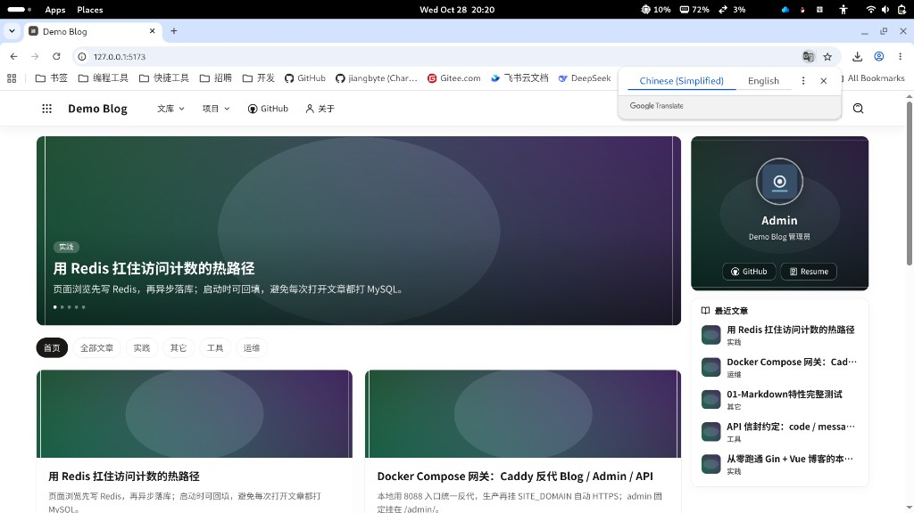
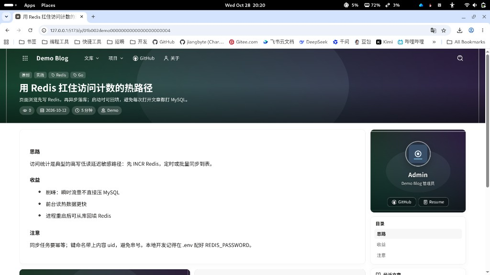
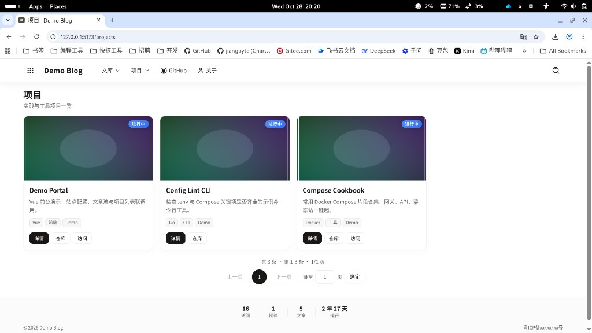
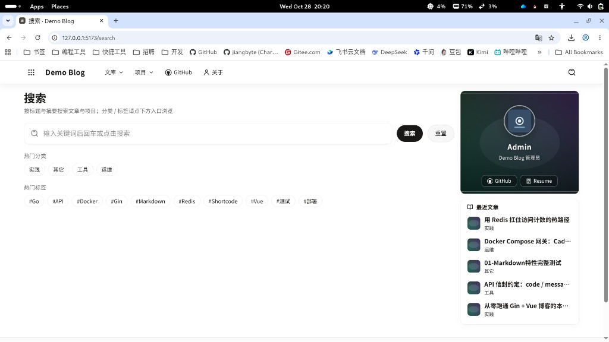
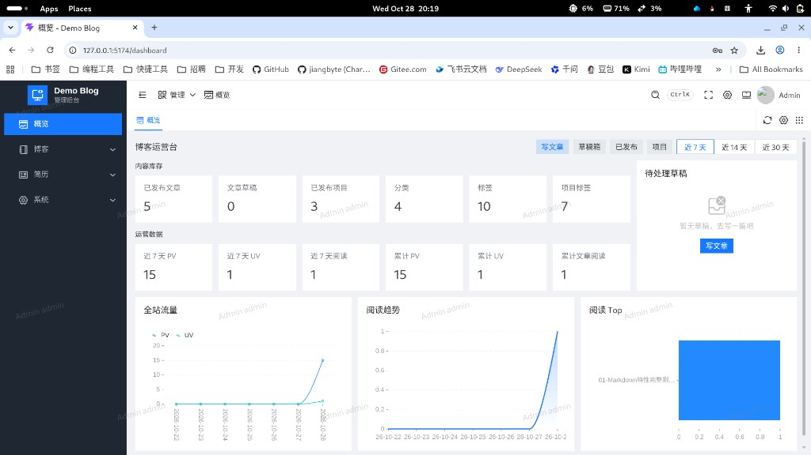
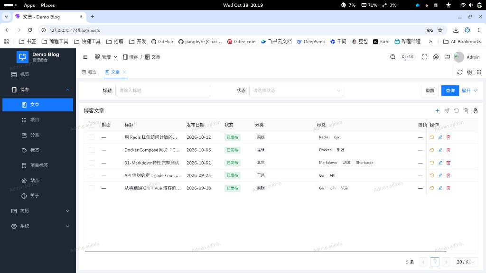
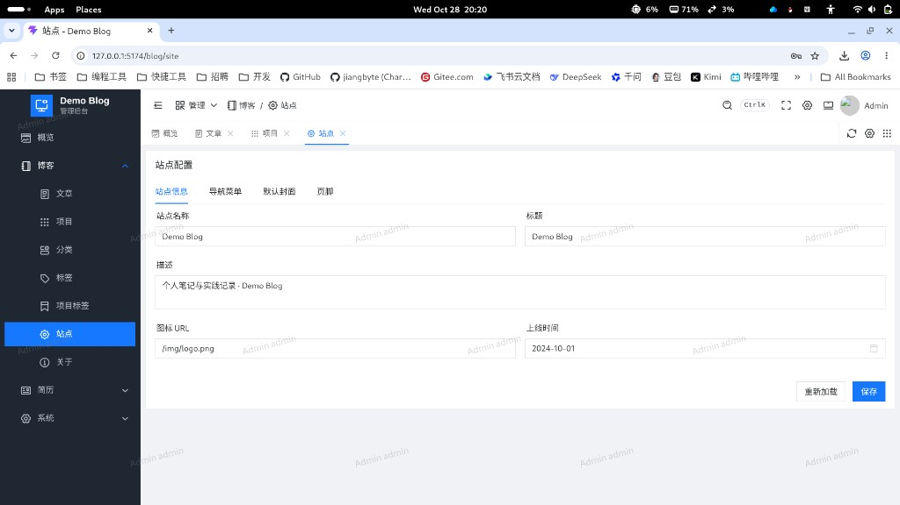
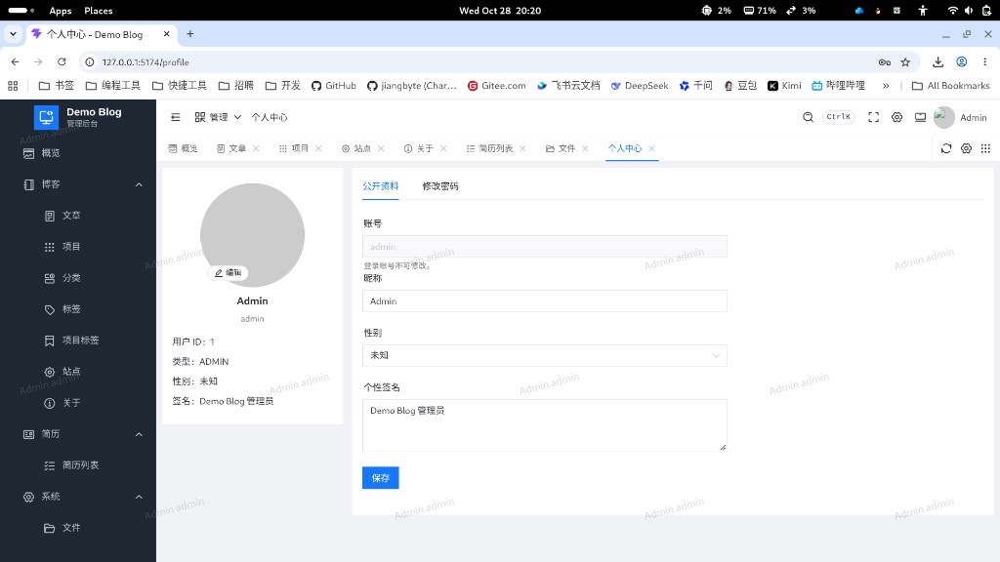

<div align="center">

# go-blog

**个人博客全栈系统**

Go（Gin + GORM）· Vue 前台 / 管理端 / 简历站 · 单管理员 · Docker 可部署

[](https://go.dev/)
[](https://gin-gonic.com/)
[](https://gorm.io/)
[](https://vuejs.org/)
[](https://www.naiveui.com/)
[](./LICENSE)
[](https://github.com/jiangbyte/go-blog/releases)

</div>

> 因为懒得维护动态博客，既不如静态模块用 Markdown 编写方便，也不便备份，所以我把之前自己做的博客系统整理出来并开源了。

---

## 目录

- [界面预览](#界面预览)
- [特性](#特性)
- [技术栈](#技术栈)
- [目录结构](#目录结构)
- [环境依赖](#环境依赖)
- [快速开始](#快速开始)
- [配置说明](#配置说明)
- [Docker 部署](#docker-部署)
- [常用命令](#常用命令)
- [API 约定](#api-约定)
- [说明](#说明)
- [许可证](#许可证)

## 界面预览

### 前台

<table>
  <tr>
    <td width="50%"></td>
    <td width="50%"></td>
  </tr>
  <tr>
    <td align="center">首页</td>
    <td align="center">文章详情</td>
  </tr>
  <tr>
    <td width="50%"></td>
    <td width="50%"></td>
  </tr>
  <tr>
    <td align="center">项目</td>
    <td align="center">搜索</td>
  </tr>
</table>

### 管理端

<table>
  <tr>
    <td width="50%"></td>
    <td width="50%"></td>
  </tr>
  <tr>
    <td align="center">概览</td>
    <td align="center">文章管理</td>
  </tr>
  <tr>
    <td width="50%"></td>
    <td width="50%"></td>
  </tr>
  <tr>
    <td align="center">站点配置</td>
    <td align="center">个人中心</td>
  </tr>
</table>

## 特性

- **内容**：文章 / 分类 / 标签、项目、归档、搜索、关于页
- **管理端**：Markdown 编辑、站点配置、文件管理（默认七牛 Kodo）
- **简历**：管理端编辑 + 公开 HTML / PDF（PDF 依赖 Chromium）
- **鉴权**：滑块验证码登录；单管理员，登录即全权限
- **约定**：路径 `/auth` · `/admin/...` · `/portal/...`；仅 GET / POST；JSON **snake_case**；信封 `{ code, message, data }`（成功 `0000`）
- **运维**：sitemap；可选 IndexNow；Caddy 网关 · Docker Compose

## 技术栈

| 层 | 选型 |
|----|------|
| API | Go · Gin · GORM · Redis |
| 前台 | Vue 3 · Vite · Tailwind |
| 管理端 | Vue 3 · Vite · Naive UI |
| 简历站 | Vue 3 · Vite |
| 存储 | 七牛 Kodo（可切 MinIO） |
| 部署 | Docker Compose · Caddy |

## 目录结构

```text
cmd/server/          API 入口
cmd/jb-md/           Markdown 上传 CLI
internal/            config / auth / blog / resume / file / storage …
docs/sql/            MySQL schema + seed
docs/seed/           Markdown 厨房水槽正文等种子资源
docs/screenshots/    README 截图
deploy/              Docker Compose、Caddy、镜像构建
web/apps/blog/       前台（:5173）
web/apps/admin/      管理端（:5174）
web/apps/resume/     简历站（:5175）
web/packages/        shared / markdown
```

## 环境依赖

| 依赖 | 说明 |
|------|------|
| Go 1.22+ | 后端 |
| Node 20+ / pnpm | 前端 monorepo |
| Docker | 本机 MySQL、Redis（本仓库**不**自起这两个容器） |
| 七牛（可选） | 对象存储；也可改回 MinIO（见 `.env.example`） |
| Chromium（可选） | 简历 PDF；Docker API 镜像已内置 |

默认约定本机已有：

| 容器 | 端口 | 示例凭证 |
|------|------|----------|
| `mysql` | 3306 | root / `infra123!`，库 `go_blog` |
| `redis` | 6379 | 密码 `infra123!` |

## 快速开始

```bash
git clone git@github.com:jiangbyte/go-blog.git
cd go-blog

make env          # 复制 .env.example → .env
# 按需编辑 .env：MySQL / Redis / 七牛 STORAGE_QINIU_* 等

make install      # go mod download + pnpm install
make sql          # 建库建表 + seed
make dev          # api + blog + admin + resume
```

默认管理员：**`admin` / `admin123`**（上线后请立刻修改）。

| 端 | 地址 |
|----|------|
| Blog | http://127.0.0.1:5173 |
| Admin | http://127.0.0.1:5174 |
| Resume | http://127.0.0.1:5175 |
| API | http://127.0.0.1:8000/health |

也可：`make api` / `make blog` / `make admin` / `make resume`。

## 配置说明

根目录 [`.env.example`](.env.example) → 复制为 `.env`。常用项：

| 变量 | 作用 |
|------|------|
| `MYSQL_*` / `REDIS_*` | 数据库与缓存 |
| `PUBLIC_SITE_URL` | 对外站点根（sitemap 等） |
| `CORS_ALLOWED_ORIGINS` | 允许的前端 Origin（逗号分隔） |
| `DEFAULT_FILE_ENGINE` | 默认 `QINIU`；需填 `STORAGE_QINIU_*` |
| `STORAGE_QINIU_BASE_URL` | CDN / 图床访问前缀 |
| `INDEXNOW_KEY` | 空则关闭；非空需在 `web/apps/blog/public/{key}.txt` 放验证文件 |
| `AUTH_RSA_KEY_PATH` | RSA 私钥；可落到 `data/`（已 gitignore） |
| `TOKEN_COOKIE_SECURE` | `true` / `false` / `auto` |

Docker 环境另见 [`deploy/.env.example`](deploy/.env.example)。

## Docker 部署

编排在 **`deploy/`**，网关 **Caddy**：未设 `SITE_DOMAIN` 仅 HTTP；生产设域名可自动 HTTPS。

```bash
cd deploy
cp .env.example .env    # 填 MySQL / Redis / 七牛等
docker compose up -d --build
# 或仓库根：make docker-up
```

本地入口：`http://127.0.0.1:8088/` · `/admin/` · `/api/health`。

生产 DNS、图床回源、简历子域、镜像推送见 **[deploy/README.md](deploy/README.md)**。

## 常用命令

| 命令 | 说明 |
|------|------|
| `make env` | 生成 `.env` |
| `make install` | 安装前后端依赖 |
| `make sql` | 执行 `docs/sql/*.sql` + Markdown 种子正文 |
| `make sql-list` / `make sql-one F=…` | 列出 / 执行单个 SQL |
| `make dev` | 本地四端 |
| `make build` | 构建 API 与前端 |
| `make jb-md` | 构建 Markdown 上传 CLI → `bin/jb-md` |
| `make docker-up` / `down` / `logs` | Compose |
| `make docker-push IMAGE_VERSION=1.0.0` | 推送镜像（需配置 registry） |

`jb-md` 详见 [`cmd/jb-md/README.md`](cmd/jb-md/README.md)。

## API 约定

- 鉴权：`GET /auth/public-key` · `POST /auth/login` · `GET /auth/me` · `POST /auth/logout`
- 管理：`/admin/...`（含博客、简历、文件、静态菜单 `user/resource/current`）
- 门户：`/portal/blog/...` · `/portal/resume/...`
- 成功码：`code = "0000"`；字段一律 `snake_case`

Blog 经 Vite 代理 `/api` → Gin。

## 说明

- 单管理员：无多用户 / 角色树。
- Seed 为演示数据，可在管理端改掉。
- 请将 `example.com`、空密钥换成自己的配置；**勿**提交 `.env`、`data/`、数据库 dump。

## 许可证

本项目基于 [MIT License](./LICENSE) 开源。

---

如果这个项目对你有帮助，欢迎 Star。
