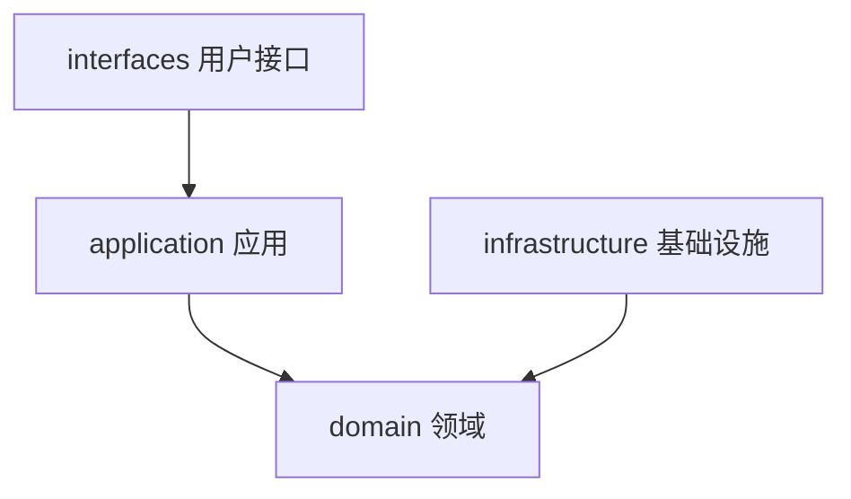
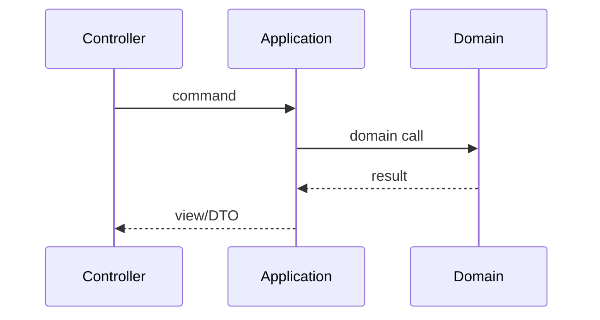
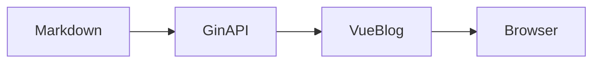

本文用于一次性冒烟：**标准 Markdown**、**GFM 扩展**、**代码块（含高亮行）**、**Mermaid fence**、**数学公式**，以及本站常用的 **增强 HTML 组件**。改主题或自定义 CSS 后，打开本页扫一眼即可。


<aside class="md-tag note info flat has-icon"><div class="note-content">

这是 go-blog 的 Markdown 厨房水槽测试文，用于回归前台渲染（CommonMark / GFM / 代码 / Mermaid / KaTeX / 增强组件）。

</div></aside>


## 1. 标题层级

下面从 `##` 到 `######`（页面标题已占用 `h1`）。

### 1.1 三级标题 H3

#### 1.1.1 四级标题 H4

##### 五级标题 H5

###### 六级标题 H6

## 2. 段落与行内强调

普通段落。同一段内可以混排 **粗体**、*斜体*、***粗斜体***、~~删除线~~，以及 `行内代码`。

还可以组合：`**` 里不该再套代码；正确写法是 **bold with `code`** 或 *italic with `code`*。

硬换行（行尾两个空格）会变成  
下一行（同一段落内的强制换行）。

软换行（单个换行）在 Markdown 里通常仍并成同一段。

## 3. 链接与图片

### 3.1 链接

- 行内链接：[Demo Blog 首页](/)
- 带标题的链接：[Hugo](https://gohugo.io/ "The world’s fastest framework")
- 自动链接：<https://example.com/>
- 参考式链接：[CodeMirror][cm-repo]

[cm-repo]: https://codemirror.net/ "CodeMirror"

站内锚点：[跳到表格](#8-表格) · [跳到 Mermaid](#11-mermaid)

### 3.2 图片

标准 Markdown 图片（远程）：


主题静态资源：


行内小图： logo。

带说明的块级图：


*public/img/default.png（站点默认封面占位）*


## 4. 列表

### 4.1 无序列表

- 苹果
- 香蕉
  - 芭蕉（嵌套）
  - 皇帝蕉
- 樱桃

### 4.2 有序列表

1. 先判断是不是 bundle
2. 不是 bundle，而且图片路径是相对路径——就用 `.Page.File.Dir` 拼绝对路径
3. 试着找一下图片资源，找不到就直接用绝对路径当 src

长文换行悬挂缩进测试：Leaf page 没有图片优化。Page bundle 的图片会被主题做 responsive resize（生成多尺寸 + srcset），leaf page 的图不会。如果对图片体积有要求，还是推荐 bundle。

### 4.3 任务列表（GFM）

- [x] 写完厨房水槽文
- [x] 同步 / 构建不报错
- [ ] 人工肉眼过一遍暗色模式
- [ ] 确认移动端 TOC 可读

### 4.4 混排

1. 有序第一项
   - 无序子项 A
   - 无序子项 B
2. 有序第二项
   1. 有序子项 2.1
   2. 有序子项 2.2

## 5. 引用

> 一级引用：分层是为了改需求时知道改哪一层。
>
> > 二级引用：依赖只能向内，不要让基础设施倒灌领域。
>
> 回到一级。引用里也可以有 **粗体** 和 `code`。

## 6. 分隔线

上一段。

---

下一段（中间是 `---`）。

***

再一段（中间是 `***`）。

## 7. 代码

### 7.1 行内

安装：`go version`，配置键：`APP_NAME`。

### 7.2 围栏代码（无高亮语言）

```
plain fence
line two
```

### 7.3 带语言

```go
package main

import "fmt"

func main() {
	fmt.Println("hello markdown")
}
```

```yaml
params:
  mermaid: true
  katex:
    enable: true
```

```bash
make dev
# API :8000 · Blog :5173 · Admin :5174
```

### 7.4 高亮行（Chroma `hl_lines`）

```go {hl_lines=[3,"5-6"]}
package demo

func Add(a, b int) int {
	return a + b
}

func main() {}
```

```html {linenos=false}

<!-- 期待：路径按 File.Dir 纠正 -->
```

## 8. 表格

| 对齐 | 左对齐 | 居中 | 右对齐 |
| :--- | :--- | :---: | ---: |
| 文本 | foo | bar | 12 |
| 代码 | `a` | `b` | 34 |
| 强调 | **粗** | *斜* | ~~删~~ |

宽表横向滚动检查：

| 维度 | Page Bundle | Leaf Page + render hook | 备注 |
| --- | --- | --- | --- |
| 图片优化 | responsive + srcset | 原图直出 | bundle 更适合大图 |
| 改造成本 | 每篇建目录 | 配置一次 | leaf 存量友好 |
| 路径稳定性 | 相对路径自然 | 绝对路径兜底 | 深层 permalink 必测 |

## 9. 脚注

这里引用一个脚注[^note-1]，再引用同一个[^note-1]，以及另一个[^note-2]。

[^note-1]: 脚注正文支持 **Markdown** 与 `code`。
[^note-2]: 第二个脚注：用于检查列表编号与返回链接。

## 10. HTML（`unsafe: true`）

<details>
<summary>原生 details / summary</summary>

里面可以继续写 Markdown 风格段落，但作为 HTML 块时以渲染器行为为准。

</details>

键盘：<kbd>Ctrl</kbd> + <kbd>K</kbd> · 高亮：<mark>mark 文本</mark> · 上标 H<sub>2</sub>O / E=mc<sup>2</sup>

缩写：<abbr title="Domain-Driven Design">DDD</abbr>

## 11. Mermaid

### 11.1 Fence（` ```mermaid `）





### 11.2 补充 Mermaid 块





## 12. 数学公式（KaTeX）

行内：勾股定理 \(a^2 + b^2 = c^2\)，以及质能 \(E = mc^2\)。

块级：

\[
\int_{-\infty}^{\infty} e^{-x^2}\,dx = \sqrt{\pi}
\]

$$
\begin{aligned}
\nabla \cdot \mathbf{E} &= \frac{\rho}{\varepsilon_0} \\
\nabla \cdot \mathbf{B} &= 0
\end{aligned}
$$

## 13. 文本与状态组件


<p class="md-tag tag-p blue">蓝色段落提示：用于较强的段落级强调。</p>


正文里的 <span class="md-tag tag-span red">红色重点</span> 与普通文字并列。

<span class="md-tag tag-label green">已完成</span>
<span class="md-tag tag-label blue">信息</span>
<span class="md-tag tag-label orange">注意</span>
<span class="md-tag tag-label purple">扩展</span>
<span class="md-tag tag-label red">危险</span>


<aside class="md-tag note info flat has-icon"><div class="note-content">

info：解释前置条件或补充背景。

</div></aside>


<aside class="md-tag note success modern has-icon"><div class="note-content">

success / modern：构建检查通过类提示。

</div></aside>


<aside class="md-tag note warning simple has-icon"><div class="note-content">

warning / simple：改配置后请重新构建。

</div></aside>


<aside class="md-tag note danger flat has-icon"><div class="note-content">

danger：需要立刻注意的问题。

</div></aside>


<aside class="md-tag note warning simple has-icon"><div class="note-content">

subnote：紧跟主提示的次级提醒。

</div></aside>


- [x] 已完成事项


- [ ] 尚未完成


- (x) 已选中


- ( ) 未选中


快捷键 <kbd>⌘ K</kbd> · 剧透 <span class="md-tag tag-spoiler" title="spoiler">答案在这里</span><span class="md-tag tag-bubble">气泡</span>

## 14. 折叠 / 隐藏 / 标签页


<details class="md-tag tag-fold"><summary class="tag-fold-summary"><span class="tag-fold-title">折叠面板（默认收起）</span></summary><div class="tag-fold-content">

折叠内支持 **Markdown** 与 `code`。

</div></details>


<details class="md-tag tag-fold" open><summary class="tag-fold-summary"><span class="tag-fold-title">折叠面板（默认展开）</span></summary><div class="tag-fold-content">

默认展开，方便检查焦点与间距。

</div></details>


行内隐藏：答案是 <details class="md-tag tag-hide-inline"><summary>查看答案</summary>hideInline</details>。


<details class="md-tag tag-hide-block"><summary>点击展开块级隐藏</summary><div>

块级隐藏内容可以包含 **Markdown**。

</div></details>


<details class="md-tag tag-hide-toggle"><summary>可切换内容</summary><div>

hideToggle：带标题的切换区域。

</div></details>


<div class="md-tag tag-tabs tabs" data-md-tabs><div class="tab-contents">
<section class="tab-item-content active" id="tab-0" data-tab-title="Go">

```go
fmt.Println("tab: go")
```

</section>
<section class="tab-item-content" id="tab-1" data-tab-title="YAML">

```yaml
theme: default
```

</section>
<section class="tab-item-content" id="tab-2" data-tab-title="说明">

标签页用于并排对比配置或代码。

</section>
</div></div>


## 15. 按钮、链接卡、内容卡

<a class="md-tag st-btn tag-button " href="https://gin-gonic.com/"><span>Gin 官网</span></a>
<a class="md-tag st-btn tag-button blue outline" href="/"><span>描边按钮</span></a>
<a class="md-tag st-btn tag-button block" href="/"><span>整行按钮</span></a>


<div class="md-tag tag-link-card"><a class="tag-link" href="https://gin-gonic.com/"><div class="tag-link-tips">链接</div><div class="tag-link-bottom"><div class="tag-link-right"><div class="tag-link-title">Gin</div><div class="tag-link-sitename">HTTP web framework written in Go</div></div></div></a></div>


<div class="md-tag tag-link-card"><a class="tag-link" href="/"><div class="tag-link-tips">链接</div><div class="tag-link-bottom"><div class="tag-link-right"><div class="tag-link-title">站内链接</div><div class="tag-link-sitename">返回首页，检查触控与焦点</div></div></div></a></div>


<article class="md-tag card_box tag-card no-cover"><a href="https://gin-gonic.com/"><div class="card_body"><span class="card_tag">纯内容</span><span class="card_title">无封面卡片</span><span class="card_description">简洁层级，不依赖本地 demo 封面。</span></div></a></article>


<article class="md-tag card_box tag-card has-cover"><a href="/"><div class="card_cover" style="background-image:url('/img/default.png')"></div><div class="card_body"><span class="card_tag">封面</span><span class="card_title">有封面卡片</span><span class="card_description">使用站点默认封面占位图。</span></div></a></article>


## 16. 时间线


<div class="md-tag timeline tag-timeline">
<div class="timeline-item md-tag timenode tag-timenode"><div class="timeline-item-title meta"><div class="item-circle"><p>Day 0</p></div></div><div class="timeline-item-content body"><strong>规划</strong><p>定分层与用例边界。</p></div></div>
<div class="timeline-item md-tag timenode tag-timenode"><div class="timeline-item-title meta"><div class="item-circle"><p>Day 1</p></div></div><div class="timeline-item-content body"><strong>实现</strong><p>竖切用户注册 / 登录。</p></div></div>
<div class="timeline-item md-tag timenode tag-timenode"><div class="timeline-item-title meta"><div class="item-circle"><p>Day 2</p></div></div><div class="timeline-item-content body"><strong>回归</strong><p>打开本页做 Markdown 冒烟。</p></div></div>
</div>


## 17. 图表与动态文字


<div class="md-tag chartjs-container tag-chart" data-chartjs-id="chart-ks"><pre class="chartjs-src" hidden>{"type":"line","data":{"labels":["一","二","三"],"datasets":[{"label":"构建次数","data":[2,5,3],"borderColor":"#4f4a45","backgroundColor":"rgba(79,74,69,0.15)"}]},"options":{"plugins":{"legend":{"display":true}},"scales":{"y":{"beginAtZero":true}}}}</pre><div class="chartjs-desc">三期构建趋势</div></div>


<p class="md-tag tag-typeit" data-typeit data-speed="55">TypeIt：用于检查动态文字与主题色是否协调。</p>


## 18. 仓库卡


<article class="md-tag repo-card tag-repo" data-repo-provider="github" data-repo-endpoint="https://api.github.com/repos/gohugoio/hugo"><div class="repo-card-header"><span class="repo-provider">GitHub</span></div><a class="repo-title" href="https://github.com/gohugoio/hugo" target="_blank" rel="noopener noreferrer">hugo</a><p class="repo-desc">github.com/gohugoio/hugo</p><div class="repo-card-footer"><span class="repo-status">仓库</span></div></article>


<article class="md-tag repo-card tag-repo" data-repo-provider="github" data-repo-endpoint="https://api.github.com/repos/gin-gonic/gin"><div class="repo-card-header"><span class="repo-provider">GitHub</span></div><a class="repo-title" href="https://github.com/gin-gonic/gin" target="_blank" rel="noopener noreferrer">gin</a><p class="repo-desc">github.com/gin-gonic/gin</p><div class="repo-card-footer"><span class="repo-status">仓库</span></div></article>


## 19. 乐谱（ABC）


<pre class="abc-music-sheet md-tag tag-score">X:1
T:Kitchen Sink
M:4/4
K:C
C D E F | G A B c |</pre>


## 20. 回归检查清单

打开本页时建议确认：

1. **目录**：非当前项无模糊，当前项高亮清晰
2. **列表**：有序圆点与首行文字垂直对齐；多行悬挂缩进
3. **代码块**：语言标、复制按钮、`hl_lines` 高亮、展开按钮
4. **Mermaid**：流程图 / 时序图为 SVG，而不是 `mermaid` 代码框
5. **公式**：行内与块级 KaTeX 已排版
6. **增强组件**：note / tabs / fold / timeline / chart / typeit 无报错样式
7. **暗色模式**：切换后文字对比度与代码块仍可读
8. **移动端**：TOC 浮层、宽表、代码块横向滚动

---

测试文结束。若某段未渲染，优先查对应渲染管线、CDN 脚本或 HTML 组件是否成对闭合。
